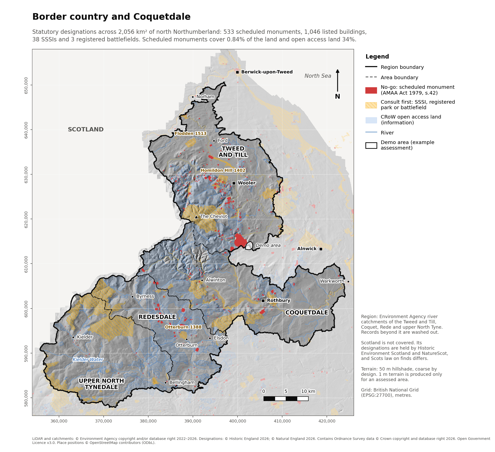

# Regional overview: border country and Coquetdale

Generated 2026-10-26. Designations downloaded
2026-10-26 from Historic England and Natural England.

The overview summarises where statutory designations lie across the region.
It does not show where to detect: that depends on the landowner's permission,
and each permission is checked separately with the area assessment.

## Region

The region is built from Environment Agency Water Framework Directive
operational catchments, listed in `region/catchments.csv`. The border country
is the land draining to the Tweed (through the Till), the Rede and the upper
North Tyne; Coquetdale is the Coquet catchment from its source to the tidal limit.

|         Area         |    Catchment     |                                     EA catchment                                     |  km²  |
|----------------------|------------------|--------------------------------------------------------------------------------------|------:|
| Tweed and Till       | Tweed River      | [3380](https://environment.data.gov.uk/catchment-planning/OperationalCatchment/3380) | 58.6  |
| Tweed and Till       | Till River       | [3379](https://environment.data.gov.uk/catchment-planning/OperationalCatchment/3379) | 574.9 |
| Coquetdale           | Coquet Upper     | [3107](https://environment.data.gov.uk/catchment-planning/OperationalCatchment/3107) | 305.4 |
| Coquetdale           | Coquet Lower     | [3105](https://environment.data.gov.uk/catchment-planning/OperationalCatchment/3105) | 291.6 |
| Redesdale            | Rede             | [3372](https://environment.data.gov.uk/catchment-planning/OperationalCatchment/3372) | 347.1 |
| Upper North Tynedale | North Tyne Upper | [3334](https://environment.data.gov.uk/catchment-planning/OperationalCatchment/3334) | 478.3 |

## Summary by area

Counts are records that touch each area; a record crossing an area boundary
counts in both, but once for the whole region. Percentages are of land area,
measured on dissolved geometries so overlapping records count once.

|         Area         |  km²   | Scheduled monuments | Scheduled land % | Listed buildings | SSSIs | SSSI % | Open access land % |
|----------------------|-------:|--------------------:|-----------------:|-----------------:|------:|-------:|-------------------:|
| Tweed and Till       | 633.4  | 298                 | 1.79             | 386              | 15    | 7.4    | 28.9               |
| Coquetdale           | 596.9  | 137                 | 0.41             | 476              | 14    | 7.3    | 34.4               |
| Redesdale            | 347.1  | 74                  | 0.97             | 103              | 7     | 6.7    | 49.4               |
| Upper North Tynedale | 478.3  | 28                  | 0.03             | 81               | 6     | 17.3   | 30.0               |
| Whole region         | 2055.7 | 533                 | 0.84             | 1046             | 38    | 9.6    | 34.2               |

## Whole region by designation

|        Designation         |  Class  | Records | Hectares | % of region |
|----------------------------|---------|--------:|---------:|------------:|
| Scheduled monument         | no-go   | 533     | 1729.8   | 0.84        |
| Registered battlefield     | consult | 3       | 789.3    | 0.38        |
| Registered park and garden | consult | 4       | 1081.9   | 0.53        |
| SSSI                       | consult | 38      | 19634.8  | 9.55        |
| CRoW access land           | info    | 1039    | 70329.0  | 34.21       |

## Registered battlefields and parks

Both are non-statutory but highly sensitive. Consult Historic England and the
local authority archaeologist before detecting on or near them.

|                                                Name                                                |        Designation         | Hectares in region |
|----------------------------------------------------------------------------------------------------|----------------------------|-------------------:|
| [Battle of Flodden 1513](https://historicengland.org.uk/listing/the-list/list-entry/1000011)       | Registered battlefield     | 282.0              |
| [Battle of Homildon Hill 1402](https://historicengland.org.uk/listing/the-list/list-entry/1000014) | Registered battlefield     | 280.1              |
| [Battle of Otterburn 1388](https://historicengland.org.uk/listing/the-list/list-entry/1000029)     | Registered battlefield     | 227.2              |
| [CHILLINGHAM (Grade II)](https://historicengland.org.uk/listing/the-list/list-entry/1001045)       | Registered park and garden | 483.7              |
| [CRAGSIDE (Grade I)](https://historicengland.org.uk/listing/the-list/list-entry/1001046)           | Registered park and garden | 404.1              |
| [HESLEYSIDE (Grade II)](https://historicengland.org.uk/listing/the-list/list-entry/1001047)        | Registered park and garden | 118.2              |
| [TILLMOUTH PARK (Grade II*)](https://historicengland.org.uk/listing/the-list/list-entry/1001053)   | Registered park and garden | 75.8               |

## Notes

- Scotland is not covered. Designations there are held by Historic Environment
  Scotland and NatureScot, and finds law differs: all finds are reported under
  Treasure Trove rather than the Treasure Act 1996.
- Berwick-upon-Tweed and the coast drain straight to the tidal Tweed or the sea,
  so they lie outside the river catchments. Designations there are still
  downloaded (`STUDY_BBOX` reaches the border), so an area there can be assessed.
- Terrain on the overview is a 50 m hillshade. LiDAR at 1 m, where
  earthworks become visible, is produced only for an assessed area.

This summary of public data is not legal advice. Check the current list entry
before detecting.
