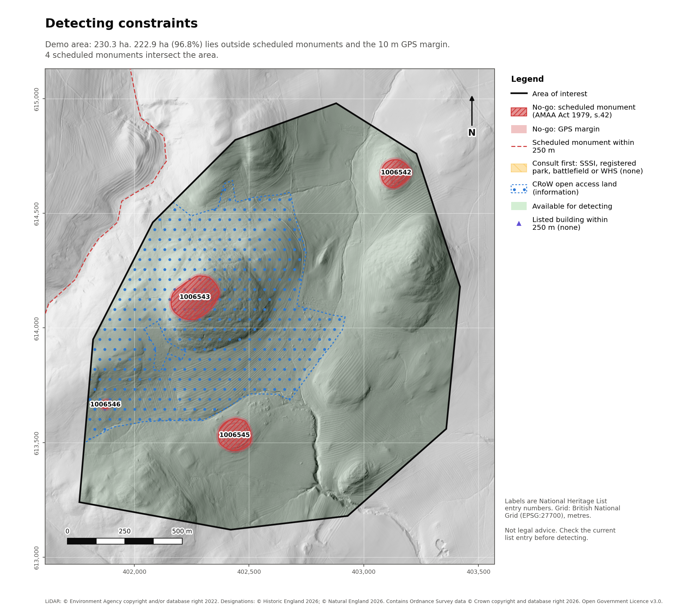
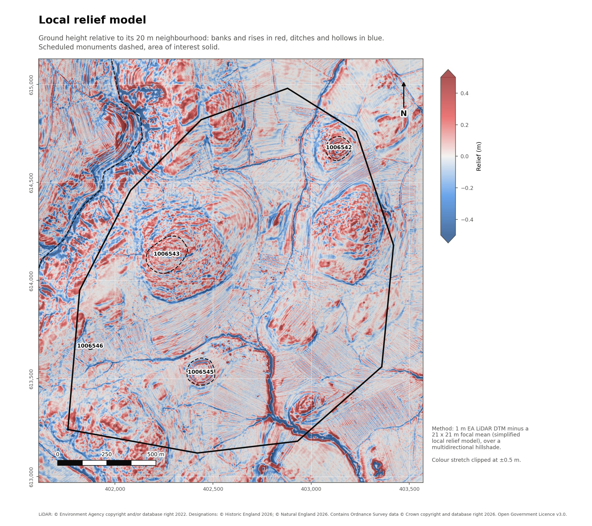

# Constraint report: demo area

Generated 2026-10-26 from `aoi/examples/demo_area.geojson`. Designations downloaded
2026-10-26 from Historic England and Natural England.

Parameters: 10 m GPS margin around scheduled monuments;
records listed within 250 m of the boundary.

## Summary

|               Measure               | Hectares | % of area |
|-------------------------------------|---------:|----------:|
| Area of interest                    | 230.26   | 100.0     |
| Scheduled monuments (legal extent)  | 5.7      | 2.5       |
| GPS margin (10 m)                   | 1.69     | 0.7       |
| Consult before detecting            | 0.0      | 0.0       |
| Open access land (information only) | 77.18    | 33.5      |
| Available for detecting             | 222.87   | 96.8      |

## No-go: scheduled monuments inside the area

Using a metal detector on a scheduled monument without written consent is an
offence under section 42 of the Ancient Monuments and Archaeological Areas Act 1979.

|                                  List entry                                   |                                Name                                | Inside area (ha) | Margin (ha) |
|-------------------------------------------------------------------------------|--------------------------------------------------------------------|-----------------:|------------:|
| [1006542](https://historicengland.org.uk/listing/the-list/list-entry/1006542) | Multivallate hillfort, 483m south west of Clinch                   | 1.182            | 0.421       |
| [1006543](https://historicengland.org.uk/listing/the-list/list-entry/1006543) | Enclosure on Old Fawdon Hill                                       | 2.848            | 0.644       |
| [1006545](https://historicengland.org.uk/listing/the-list/list-entry/1006545) | Iron age defended settlement, 500m south west of Broomycrook Knowe | 1.568            | 0.478       |
| [1006546](https://historicengland.org.uk/listing/the-list/list-entry/1006546) | Old Fawdon Hill West camp                                          | 0.105            | 0.148       |

## Scheduled monuments near the area

|                                  List entry                                   |                                          Name                                           | Distance (m) |
|-------------------------------------------------------------------------------|-----------------------------------------------------------------------------------------|-------------:|
| [1021382](https://historicengland.org.uk/listing/the-list/list-entry/1021382) | Ingram Farm: prehistoric to post-medieval settlement, agricultural and funerary remains | 123.0        |

## Other designations inside the area

|   Designation    |          Name          | Class | Inside area (ha) |                                                                                 Guidance                                                                                 |
|------------------|------------------------|-------|-----------------:|--------------------------------------------------------------------------------------------------------------------------------------------------------------------------|
| CRoW access land | Section 4 open country | info  | 77.181           | The public right of access excludes metal detecting (Countryside and Rights of Way Act 2000, Sch. 2). Detecting relies on the landowner's permission, not access rights. |

## Listed buildings within 250 m

None.

## Terrain

|     Measure     |  Min  |  Max  | Mean  |
|-----------------|------:|------:|------:|
| Elevation (m)   | 157.7 | 314.7 | 219.2 |
| Slope (degrees) | 0.0   | 50.8  | 9.9   |

## Before detecting

- Written permission from the landowner and, where different, the occupier.
- Check each list entry above for changes since the download date.
- Follow the Code of Practice for Responsible Metal Detecting in England and Wales.
- Report potential Treasure to the coroner within 14 days (Treasure Act 1996) and
  record other finds with the Portable Antiquities Scheme.

This report summarises public designation data. It is not legal advice.
